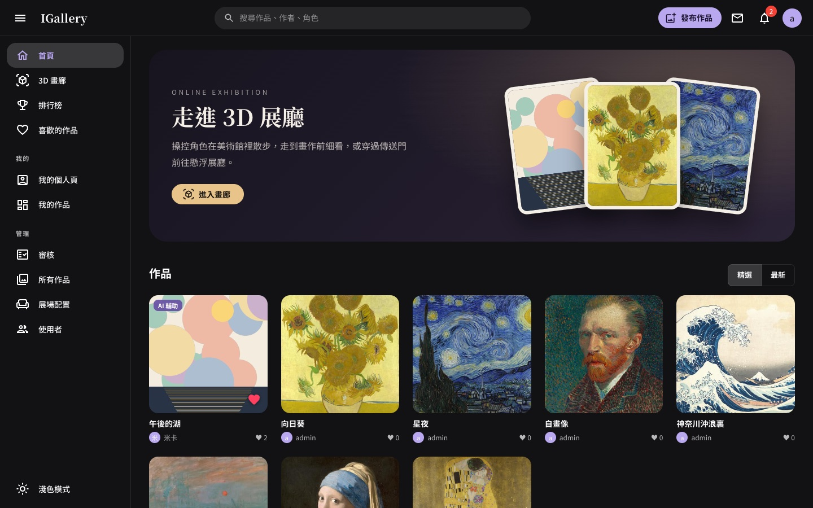
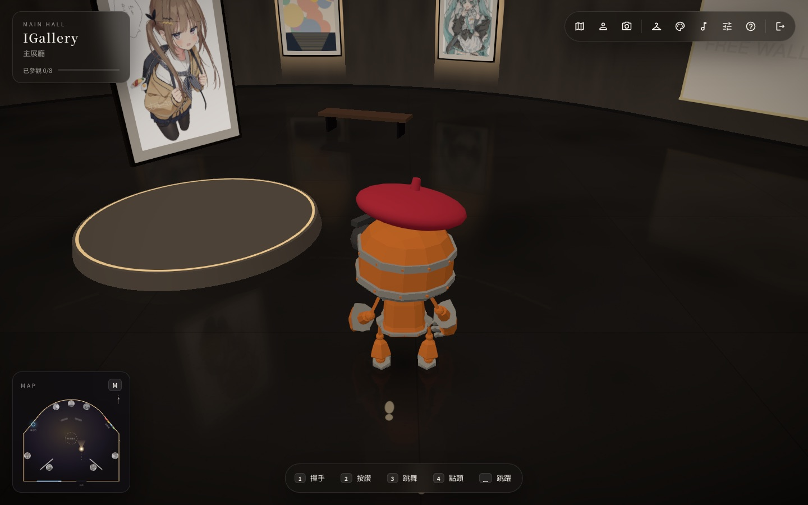
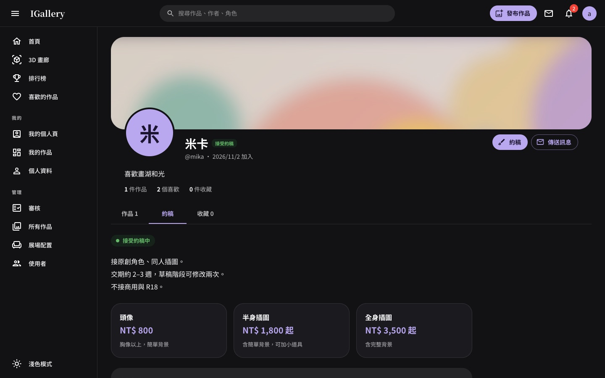
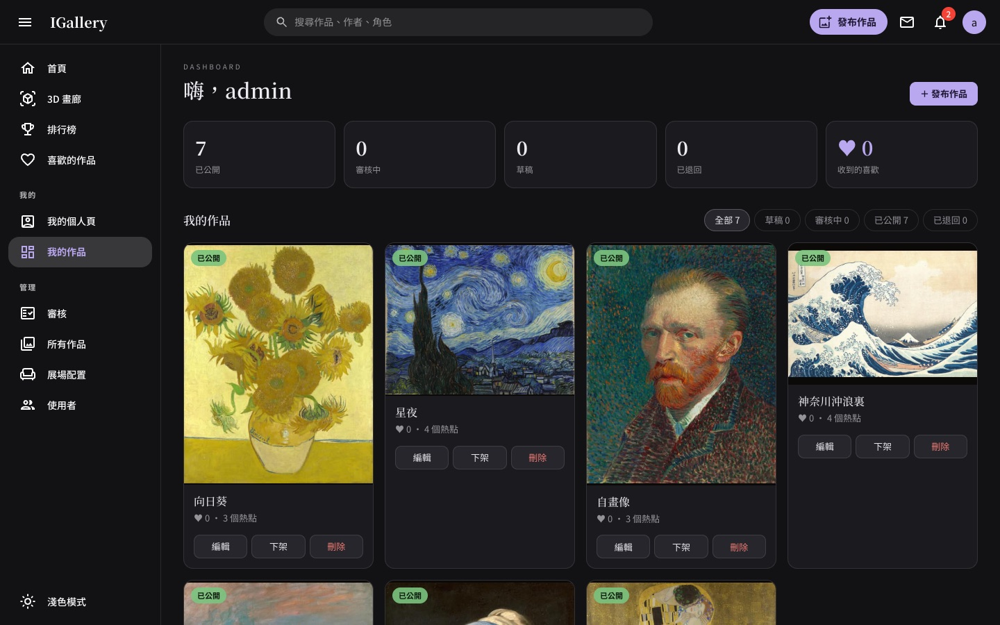
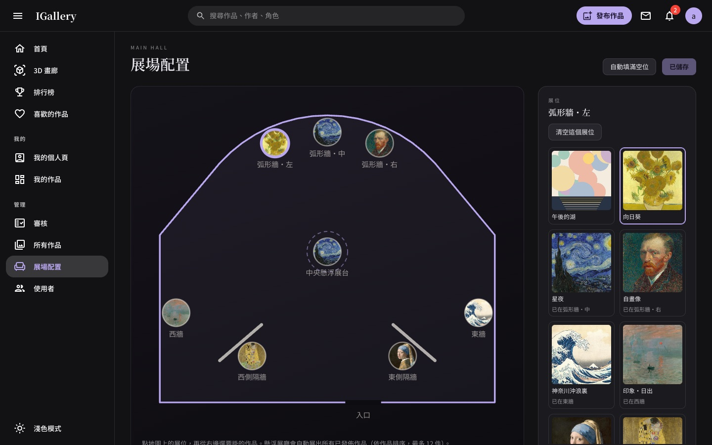
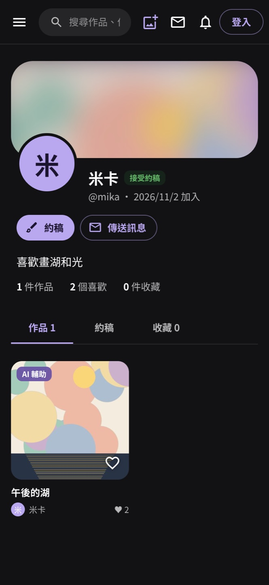

<div align="center">

# IGallery

**一座可以走進去逛的線上美術館**

創作者上傳作品、經過審核後公開；觀眾可以像逛社群一樣瀏覽作品、按愛心收藏、看作者的個人頁，<br>
也可以操控角色走進 3D 展廳，在畫作前停下來細看。

### [👉 立即參觀 i-gallery-seven.vercel.app](https://i-gallery-seven.vercel.app/)

不用註冊，點「以訪客身分進入」就能逛；註冊會員即可上傳作品、按愛心收藏。

<br>



</div>

## 走進 3D 展廳



- **自由漫步**：第一人稱視角，WASD 移動、點一下畫面後用滑鼠轉動視角（Esc 放開游標，也可拖曳或用 Q/E、方向鍵轉向），V 可切到第三人稱，空白鍵跳躍、Shift 衝刺、X 蹲下，設定中可調視角靈敏度；靠近畫作會自動聚焦，牆上說明牌顯示作品名稱、作者、角色與描述
- **細看作品**：點擊進入細節頁，看原圖、作者標記的細節熱點與作品背後的故事
- **導覽地圖**：左下角小地圖顯示位置與足跡，`M` 開啟完整地圖，點作品直接前往；看過的作品會點亮並記錄參觀進度
- **美術館級的展場**：掃描 PBR 材質的地板與牆面、環境光與環境光遮蔽；每幅畫背後有深色主題色牆、頭頂有對準它的投射燈；獨立展牆兩端彎成弧形翼牆，背面是流線柱紋浮雕
- **三個展廳**：
  - **主展廳**：中央展台上漂浮旋轉的畫作就是通往「夏日祭典」的入口；還有一面可以留下自己塗鴉的牆
  - **夏日祭典**：黃昏的環形迴廊圍著枯山水庭園，竹林、盛開的百日紅與漂浮的和傘，天上不時放煙火；作品掛在床之間風格的展示凹室裡，由和紙燈箱打光
  - **樓上跑酷**：主展廳西北角的樓梯通往樓上，一連串懸在夜空裡的平台要邊跑邊跳才能過，掉下去會回到最近的存檔點；跑到終點才有通往懸浮展廳的門
  - **懸浮展廳**：畫作在星空下繞著展廳中心緩緩公轉，各有自己的軌道半徑與高度，微微上下飄移；天花板的投影機把正在看的作品投在地面
- **看得見對面的傳送門**：細金屬拱門裡會即時顯示目的地展廳的景象與展出的畫，換角度看有視差，像一扇真的門
- **氛圍**：夜間美術館／白盒／暖木三種主題；主展廳、夏日祭典各有自己的配樂，樓上跑酷與懸浮展廳共用一首〈森へ〉，換展廳時交叉淡入；腳步聲、進場運鏡與聚光燈
- **小芽苗**：代表你的圓滾滾小角色，走路會搖擺、跳起來會拉長、落地會壓扁回彈，可以換裝；攝影模式能調整景深拍下自己的參觀照

## 像社群一樣探索作品

<table>
<tr>
<td width="50%"></td>
<td width="50%"></td>
</tr>
<tr>
<td><b>作者個人頁</b>：作品、約稿方案與收藏一頁看完，收藏可以設為不公開</td>
<td><b>工作室</b>：上傳作品、追蹤審核狀態與收到的喜歡，預設深色模式，也可以切換成淺色</td>
</tr>
<tr>
<td width="50%"></td>
<td width="50%" align="center"></td>
</tr>
<tr>
<td><b>展場配置</b>：管理者在平面圖上決定每面牆掛哪一幅畫</td>
<td><b>手機版</b>：側欄收進選單，每一頁都能在手機上使用</td>
</tr>
</table>

- **首頁**：精選與最新作品、搜尋作品／作者／角色；「排行榜」頁依收到的喜歡數為藝術家排名
- **AI 標註**：每件作品上傳時都必須標明「未使用 AI／AI 輔助／AI 生成」，並顯示在作品上
- **審核制度**：會員送審、管理者核准或附原因退回，只有通過的作品會公開
- **通知**：作品被喜歡、審核結果、角色變更都會收到站內通知
- **帳號**：訪客一鍵進入、隨時升級成會員且保留同一個帳號

## 技術架構

| 功能 | 內容 | 技術 |
|---|---|---|
| 網站 | 首頁、作品頁、作者個人頁、排行榜、通知；手機版 | React 19、MUI、hash 路由 |
| 3D 展廳 | 三個展廳、角色操控、碰撞、導覽地圖、攝影模式 | Three.js、React Three Fiber、drei、Zustand |
| 展場質感 | 掃描 PBR 材質、程序生成的弧形展牆與浮雕、投射燈與接觸陰影 | Poly Haven CC0 材質（WebP）、ExtrudeGeometry、烘焙頂點光影 |
| 光影與後製 | 環境光、環境光遮蔽、光暈、景深、暗角、反射地板 | drei Environment／Lightformer、N8AO、postprocessing、MeshReflectorMaterial |
| 傳送門 | 門內即時渲染目的地展廳，有視差 | drei MeshPortalMaterial |
| 音效與配樂 | 各展廳配樂交叉淡入、即時合成音樂、腳步聲 | Web Audio API |
| 效能 | 依裝置自動選畫質；靜止時降到低幀率；畫作先載預覽圖，走近才換原圖 | 按需渲染（frameloop demand）、sharp 產生預覽圖 |
| 工作室與後台 | 上傳作品、送審、審核、藝術家申請、展場配置、使用者管理 | React、MUI、SVG 平面圖 |
| 後端 API | 帳號、作品、喜歡、通知、展位；部署成 Vercel Function | Node.js、TypeScript、Hono、HttpOnly cookie |
| 資料庫 | 使用者、作品、喜歡、通知、展位 | PostgreSQL（正式環境 Neon，本機內嵌 PGlite） |
| 圖片 | 原圖與預覽圖 | Vercel Blob（瀏覽器直接上傳） |
| 數據 | 頁面瀏覽統計 | Vercel Analytics |

整個專案都在 [`frontend/`](frontend)，前端與 API 部署成同一個 Vercel 專案。資料庫結構變更寫在 `api/_lib/db.ts` 的 `MIGRATIONS`，部署後第一次呼叫 API 時自動套用；欄位長度等限制放在 `src/shared/artworkLimits.json`，前端表單和後端驗證共用同一份。

## 本機開發

不需要任何雲端帳號：資料庫用內嵌的 PGlite，圖片存在 `frontend/.data/`。

```bash
cd frontend
npm install
npm run dev
```

- 網站：http://localhost:3000
- 3D 畫廊：http://localhost:3000/#gallery
- 登入／工作室：http://localhost:3000/#login（本機預設管理者 `admin`／`igallery-dev`）

第一次啟動會自動匯入 `public/artworks/` 裡的 7 件範例作品（見下方「範例作品」）。想重來的話，刪掉 `frontend/.data/` 再啟動即可。

其他指令：

| 指令 | 用途 |
|---|---|
| `npm run typecheck` | 檢查 API 的 TypeScript 型別 |
| `npm run db:seed` | 資料庫是空的時候匯入範例作品（有設定 `DATABASE_URL` 就匯入到 Neon） |
| `npm run build` | 建置正式版前端 |

## 部署到 Vercel

1. 在 Vercel 匯入這個 GitHub repo，**Root Directory 設成 `frontend`**，Framework 會自動偵測為 Create React App。
2. 在專案的 **Storage** 分頁建立兩個資源，Vercel 會自動加入對應的環境變數：
   - **Neon**（Postgres）→ `DATABASE_URL`
   - **Blob** → `BLOB_STORE_ID`（透過 Vercel OIDC 授權，也支援舊的 `BLOB_READ_WRITE_TOKEN`）。建立時選擇 **Public** 存取，3D 畫廊需要直接讀取圖片。
3. 在 **Settings → Environment Variables** 加入第一個管理者帳號：
   - `ADMIN_USERNAME`
   - `ADMIN_PASSWORD`（請用夠長的密碼）

   資料庫裡還沒有任何管理者時，第一次呼叫 API 就會用這組帳密建立帳號。
4. 部署。資料表會在第一次呼叫 API 時自動建立。
5. （選擇性）匯入範例作品：把 Neon 的 `DATABASE_URL` 放進 `frontend/.env.local`，執行 `npm run db:seed`。

完整的環境變數說明見 [`frontend/.env.example`](frontend/.env.example)。

## 帳號與權限

| 角色 | 可以做什麼 |
|---|---|
| 訪客 | 從登入頁一鍵進入，有自己的 dashboard 與 profile，只能瀏覽；可以隨時升級成會員（同一個帳號） |
| 會員 | 註冊帳號＋密碼；對作品按喜歡收藏、有自己的個人頁；可以申請成為藝術家 |
| 藝術家 | 會員申請、管理者核准後取得；發布作品（必須標註是否使用 AI）、編輯、送出審核、設定約稿 |
| 管理者 | 藝術家的所有功能，加上作品審核、藝術家申請審核、所有作品排序、展場配置、使用者管理（改角色、重設密碼、刪除） |

第一個管理者由 `ADMIN_USERNAME`／`ADMIN_PASSWORD` 建立，之後可以在「使用者」頁調整角色。會員忘記密碼時由管理者重設。

成為藝術家：會員填寫自我介紹與作品集連結送出申請 → 管理者在「藝術家申請」核准（角色改為藝術家）或附原因不通過（可以補充後再申請），結果都會通知申請者。

作品狀態：草稿 → 送審（審核中）→ 管理者核准（已公開）或退回（附原因，修改後可再送審）。只有已公開的作品會出現在首頁、排行與畫廊。

## 範例作品

`frontend/public/artworks/` 內附的範例作品都是已進入公有領域的名畫，圖檔取自 Wikimedia Commons：

| 作品 | 作者 | 年代 | 來源 |
|---|---|---|---|
| 星夜 | 文森・梵谷 | 1889 | [Wikimedia Commons](https://commons.wikimedia.org/wiki/File:Van_Gogh_-_Starry_Night_-_Google_Art_Project.jpg) |
| 向日葵 | 文森・梵谷 | 1888 | [Wikimedia Commons](https://commons.wikimedia.org/wiki/File:Vincent_Willem_van_Gogh_127.jpg) |
| 自畫像 | 文森・梵谷 | 1887 | [Wikimedia Commons](https://commons.wikimedia.org/wiki/File:Vincent_van_Gogh_-_Self-Portrait_-_Google_Art_Project_(454045).jpg) |
| 戴珍珠耳環的少女 | 約翰尼斯・維梅爾 | 約 1665 | [Wikimedia Commons](https://commons.wikimedia.org/wiki/File:1665_Girl_with_a_Pearl_Earring.jpg) |
| 神奈川沖浪裏 | 葛飾北齋 | 約 1831 | [Wikimedia Commons](https://commons.wikimedia.org/wiki/File:Tsunami_by_hokusai_19th_century.jpg) |
| 印象・日出 | 克勞德・莫內 | 1872 | [Wikimedia Commons](https://commons.wikimedia.org/wiki/File:Monet_-_Impression,_Sunrise.jpg) |
| 吻 | 古斯塔夫・克林姆 | 1907–1908 | [Wikimedia Commons](https://commons.wikimedia.org/wiki/File:The_Kiss_-_Gustav_Klimt_-_Google_Cultural_Institute.jpg) |

展廳的地板與牆面材質來自 [Poly Haven](https://polyhaven.com/)（CC0）：`concrete_floor_worn_001`、`laminate_floor_02`、`plaster_grey_04`，轉成可依主題染色的 WebP 放在 `frontend/public/textures/`。
