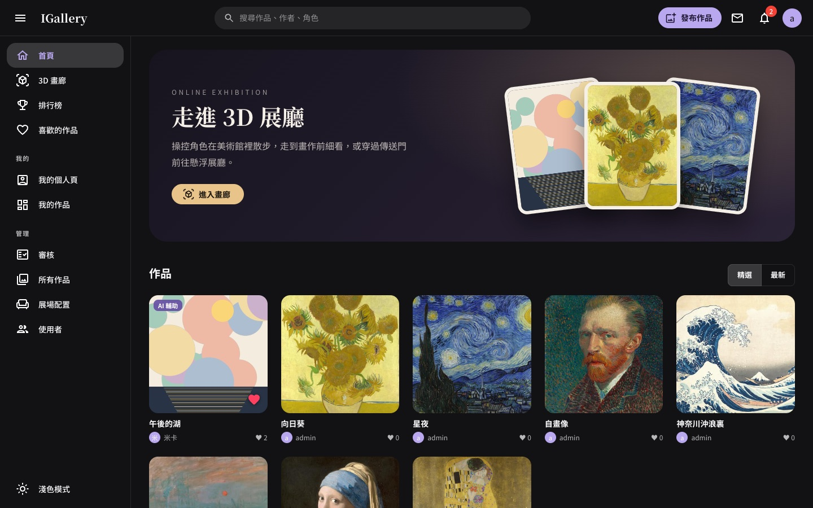
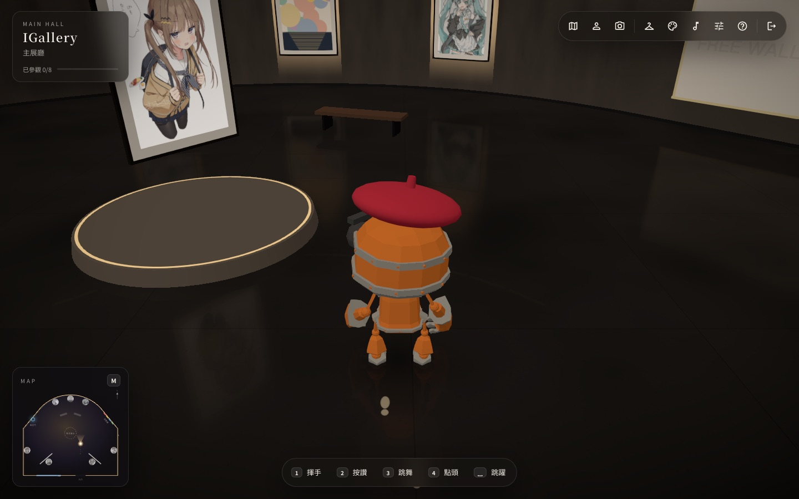
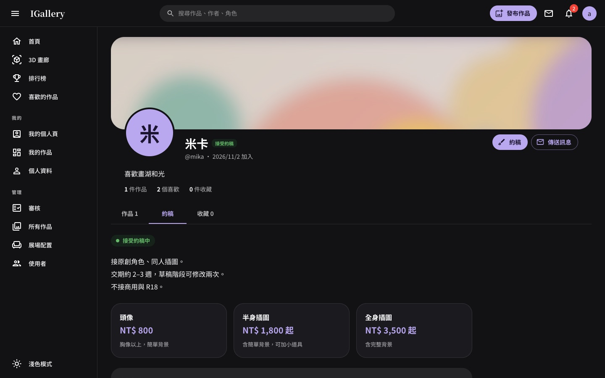
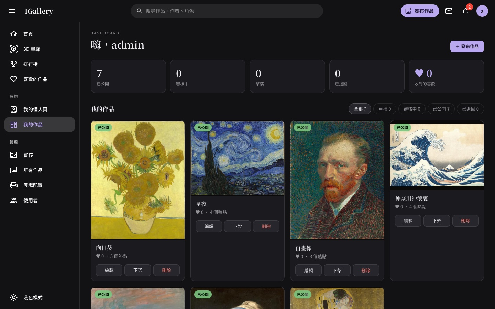
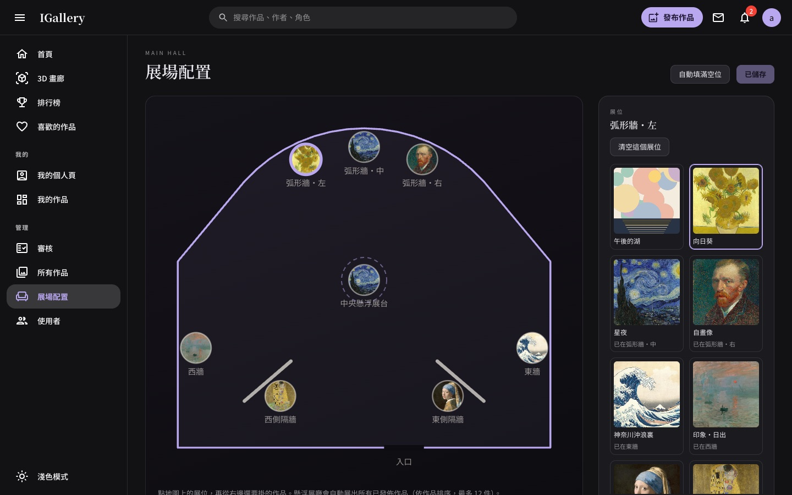
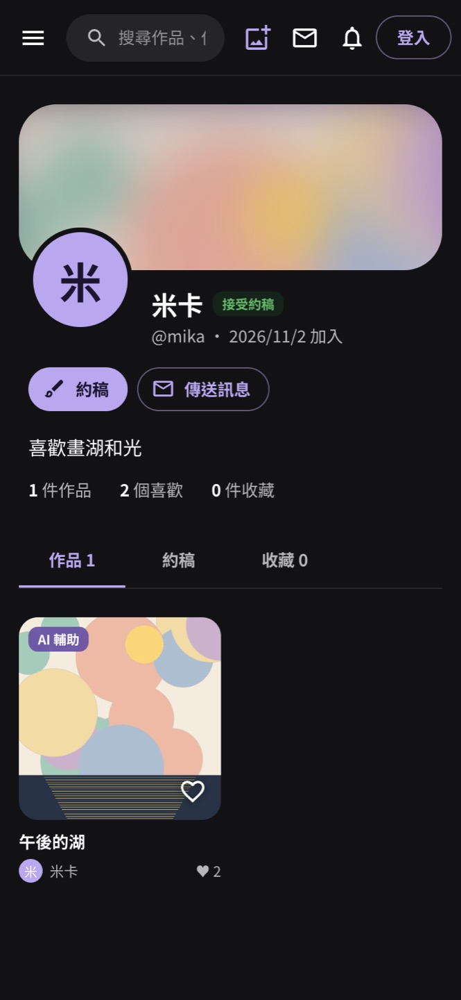

<div align="center">

# IGallery

**一座可以走進去逛的線上美術館**

創作者上傳作品、經過審核後公開；觀眾可以像逛社群一樣瀏覽作品、按愛心收藏、看作者的個人頁，<br>
也可以操控角色走進 3D 展廳，在畫作前停下來細看。

### [👉 立即參觀 i-gallery-seven.vercel.app](https://i-gallery-seven.vercel.app/)

不用註冊，點「以訪客身分進入」就能逛；註冊會員即可上傳作品、按愛心收藏。

<br>



</div>

## 走進 3D 展廳



- **自由漫步**：WASD 走路、拖曳轉視角，靠近畫作會自動聚焦，牆上說明牌顯示作品名稱、作者、角色與描述
- **細看作品**：點擊進入細節頁，看原圖、作者標記的細節熱點與作品背後的故事
- **導覽地圖**：左下角小地圖顯示位置與足跡，`M` 開啟完整地圖，點作品直接前往；看過的作品會點亮並記錄參觀進度
- **多個展廳**：走出主展廳大門是夜晚的「夏日祭典」：鳥居、屋台攤位、櫓與燈籠串，天上不時放煙火；穿過傳送門則到懸浮展廳。主展廳還有一面可以留下自己塗鴉的牆
- **氛圍**：夜間美術館／白盒／暖木三種主題；主展廳與夏日祭典各有自己的配樂，換展廳時交叉淡入，懸浮展廳是即時合成的音樂；腳步聲、進場運鏡與聚光燈
- **小機器人**：可以換裝、揮手、跳舞、跳躍；攝影模式能調整景深拍下自己的參觀照

## 像社群一樣探索作品

<table>
<tr>
<td width="50%"></td>
<td width="50%"></td>
</tr>
<tr>
<td><b>作者個人頁</b>：作品、約稿方案與收藏一頁看完，收藏可以設為不公開</td>
<td><b>工作室</b>：上傳作品、追蹤審核狀態與收到的喜歡，預設深色模式，也可以切換成淺色</td>
</tr>
<tr>
<td width="50%"></td>
<td width="50%" align="center"></td>
</tr>
<tr>
<td><b>展場配置</b>：管理者在平面圖上決定每面牆掛哪一幅畫</td>
<td><b>手機版</b>：側欄收進選單，每一頁都能在手機上使用</td>
</tr>
</table>

- **首頁**：精選與最新作品、搜尋作品／作者／角色；「排行榜」頁依收到的喜歡數為藝術家排名
- **AI 標註**：每件作品上傳時都必須標明「未使用 AI／AI 輔助／AI 生成」，並顯示在作品上
- **審核制度**：會員送審、管理者核准或附原因退回，只有通過的作品會公開
- **通知**：作品被喜歡、審核結果、角色變更都會收到站內通知
- **帳號**：訪客一鍵進入、隨時升級成會員且保留同一個帳號

## 技術架構

| 位置 | 內容 | 技術 |
|---|---|---|
| `frontend/src/` | 網站、3D 畫廊（`#gallery`）、工作室（`#me`、`#admin`） | React 19、MUI、Three.js（React Three Fiber） |
| `frontend/api/` | 後端 API，部署成 Vercel Function | Node.js、TypeScript、Hono |
| 資料庫 | 使用者、作品、喜歡、通知、展位 | PostgreSQL（正式環境 Neon，本機內嵌 PGlite） |
| 圖片 | 原圖與預覽圖 | Vercel Blob（瀏覽器直接上傳） |

整個專案都在 [`frontend/`](frontend)，前端與 API 部署成同一個 Vercel 專案。

## 本機開發

不需要任何雲端帳號：資料庫用內嵌的 PGlite，圖片存在 `frontend/.data/`。

```bash
cd frontend
npm install
npm run dev
```

- 網站：http://localhost:3000
- 3D 畫廊：http://localhost:3000/#gallery
- 登入／工作室：http://localhost:3000/#login（本機預設管理者 `admin`／`igallery-dev`）

第一次啟動會自動匯入 `public/artworks/` 裡的 7 件範例作品（見下方「範例作品」）。想重來的話，刪掉 `frontend/.data/` 再啟動即可。

其他指令：

| 指令 | 用途 |
|---|---|
| `npm run typecheck` | 檢查 API 的 TypeScript 型別 |
| `npm run db:seed` | 資料庫是空的時候匯入範例作品（有設定 `DATABASE_URL` 就匯入到 Neon） |
| `npm run build` | 建置正式版前端 |

## 部署到 Vercel

1. 在 Vercel 匯入這個 GitHub repo，**Root Directory 設成 `frontend`**，Framework 會自動偵測為 Create React App。
2. 在專案的 **Storage** 分頁建立兩個資源，Vercel 會自動加入對應的環境變數：
   - **Neon**（Postgres）→ `DATABASE_URL`
   - **Blob** → `BLOB_STORE_ID`（透過 Vercel OIDC 授權，也支援舊的 `BLOB_READ_WRITE_TOKEN`）。建立時選擇 **Public** 存取，3D 畫廊需要直接讀取圖片。
3. 在 **Settings → Environment Variables** 加入第一個管理者帳號：
   - `ADMIN_USERNAME`
   - `ADMIN_PASSWORD`（請用夠長的密碼）

   資料庫裡還沒有任何管理者時，第一次呼叫 API 就會用這組帳密建立帳號。
4. 部署。資料表會在第一次呼叫 API 時自動建立。
5. （選擇性）匯入範例作品：把 Neon 的 `DATABASE_URL` 放進 `frontend/.env.local`，執行 `npm run db:seed`。

完整的環境變數說明見 [`frontend/.env.example`](frontend/.env.example)。

## 帳號與權限

| 角色 | 可以做什麼 |
|---|---|
| 訪客 | 從登入頁一鍵進入，有自己的 dashboard 與 profile，只能瀏覽；可以隨時升級成會員（同一個帳號） |
| 會員 | 註冊帳號＋密碼；對作品按喜歡收藏、有自己的個人頁；可以申請成為藝術家 |
| 藝術家 | 會員申請、管理者核准後取得；發布作品（必須標註是否使用 AI）、編輯、送出審核、設定約稿 |
| 管理者 | 藝術家的所有功能，加上作品審核、藝術家申請審核、所有作品排序、展場配置、使用者管理（改角色、重設密碼、刪除） |

第一個管理者由 `ADMIN_USERNAME`／`ADMIN_PASSWORD` 建立，之後可以在「使用者」頁調整角色。會員忘記密碼時由管理者重設。

成為藝術家：會員填寫自我介紹與作品集連結送出申請 → 管理者在「藝術家申請」核准（角色改為藝術家）或附原因不通過（可以補充後再申請），結果都會通知申請者。

作品狀態：草稿 → 送審（審核中）→ 管理者核准（已公開）或退回（附原因，修改後可再送審）。只有已公開的作品會出現在首頁、排行與畫廊。

## API

| 方法 | 路徑 | 權限 | 說明 |
|---|---|---|---|
| GET | `/api/artworks`、`/api/artworks/:id` | 公開 | 已公開的作品（含上傳者、AI 標註、喜歡數） |
| POST／DELETE | `/api/artworks/:id/like` | 會員 | 喜歡／取消喜歡（不能對自己的作品） |
| GET | `/api/artists/ranking` | 公開 | 依作品收到的喜歡數排名 |
| GET | `/api/users/:id` | 公開 | 作者個人頁：資料、約稿資訊、統計 |
| GET | `/api/users/:id/artworks` | 公開 | 作者已公開的作品 |
| GET | `/api/users/:id/favorites` | 公開 | 作者的收藏（未公開時只有本人看得到） |
| GET | `/api/exhibition` | 公開 | 3D 畫廊用：已公開作品與展位配置 |
| POST | `/api/auth/register`、`login`、`guest`、`logout` | 公開 | 註冊、登入、訪客進入、登出（HttpOnly cookie） |
| GET | `/api/auth/me` | 登入 | 目前的使用者 |
| POST | `/api/auth/upgrade` | 訪客 | 升級成會員 |
| PUT | `/api/auth/password` | 會員 | 變更密碼 |
| PATCH | `/api/me/profile` | 登入 | 顯示名稱、自我介紹、收藏是否公開、約稿設定 |
| GET | `/api/me/dashboard` | 登入 | 自己的作品統計 |
| GET | `/api/me/notifications`、`/api/me/notifications/unread` | 登入 | 通知列表／未讀數（前端每分鐘輪詢） |
| POST | `/api/me/notifications/read` | 登入 | 標為已讀（帶 `ids` 只標指定的，不帶就全部） |
| GET／POST | `/api/me/artist-application` | 會員 | 自己最新的藝術家申請／送出申請 |
| GET／POST | `/api/me/artworks` | 藝術家 | 自己的作品／新增作品 |
| GET／PATCH／DELETE | `/api/me/artworks/:id` | 擁有者或管理者 | 讀取／修改／刪除 |
| POST | `/api/me/artworks/:id/submit`、`withdraw` | 擁有者 | 送審／撤回（管理者送出即公開） |
| POST | `/api/uploads/blob`、`/api/uploads/local` | 藝術家 | 圖片上傳授權（正式環境）／本機上傳 |
| GET／PATCH／DELETE | `/api/admin/artworks[/:id]` | 管理者 | 所有作品 |
| POST | `/api/admin/artworks/:id/approve`、`reject` | 管理者 | 核准／退回 |
| PUT | `/api/admin/artworks/order` | 管理者 | 排序 |
| GET／PUT | `/api/admin/exhibition` | 管理者 | 展位配置 |
| GET／PATCH／DELETE | `/api/admin/users[/:id]`、POST `/:id/password` | 管理者 | 使用者管理 |
| GET | `/api/admin/artist-applications` | 管理者 | 待審核的藝術家申請 |
| POST | `/api/admin/artist-applications/:id/approve`、`reject` | 管理者 | 核准／不通過（附原因） |

所有修改請求都必須是 JSON 並帶 `x-igallery: 1` 標頭（防 CSRF）。資料庫結構變更寫在 `api/_lib/db.ts` 的 `MIGRATIONS`，部署後第一次呼叫 API 時自動套用。欄位長度等限制放在 `src/shared/artworkLimits.json`，前端表單和後端驗證共用同一份。

## 範例作品

`frontend/public/artworks/` 內附的範例作品都是已進入公有領域的名畫，圖檔取自 Wikimedia Commons：

| 作品 | 作者 | 年代 | 來源 |
|---|---|---|---|
| 星夜 | 文森・梵谷 | 1889 | [Wikimedia Commons](https://commons.wikimedia.org/wiki/File:Van_Gogh_-_Starry_Night_-_Google_Art_Project.jpg) |
| 向日葵 | 文森・梵谷 | 1888 | [Wikimedia Commons](https://commons.wikimedia.org/wiki/File:Vincent_Willem_van_Gogh_127.jpg) |
| 自畫像 | 文森・梵谷 | 1887 | [Wikimedia Commons](https://commons.wikimedia.org/wiki/File:Vincent_van_Gogh_-_Self-Portrait_-_Google_Art_Project_(454045).jpg) |
| 戴珍珠耳環的少女 | 約翰尼斯・維梅爾 | 約 1665 | [Wikimedia Commons](https://commons.wikimedia.org/wiki/File:1665_Girl_with_a_Pearl_Earring.jpg) |
| 神奈川沖浪裏 | 葛飾北齋 | 約 1831 | [Wikimedia Commons](https://commons.wikimedia.org/wiki/File:Tsunami_by_hokusai_19th_century.jpg) |
| 印象・日出 | 克勞德・莫內 | 1872 | [Wikimedia Commons](https://commons.wikimedia.org/wiki/File:Monet_-_Impression,_Sunrise.jpg) |
| 吻 | 古斯塔夫・克林姆 | 1907–1908 | [Wikimedia Commons](https://commons.wikimedia.org/wiki/File:The_Kiss_-_Gustav_Klimt_-_Google_Cultural_Institute.jpg) |
